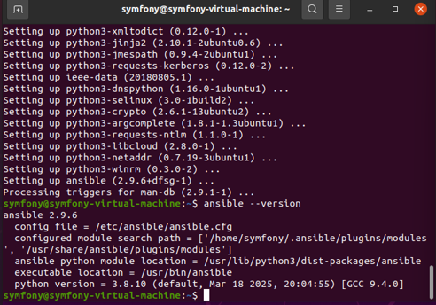
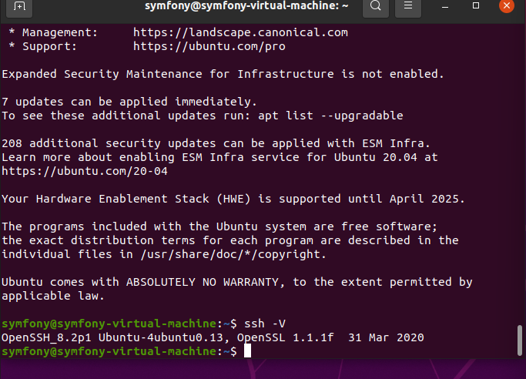
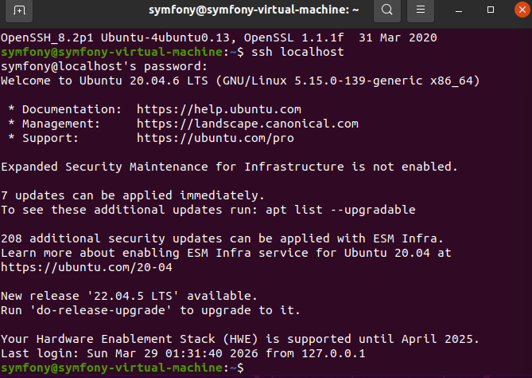
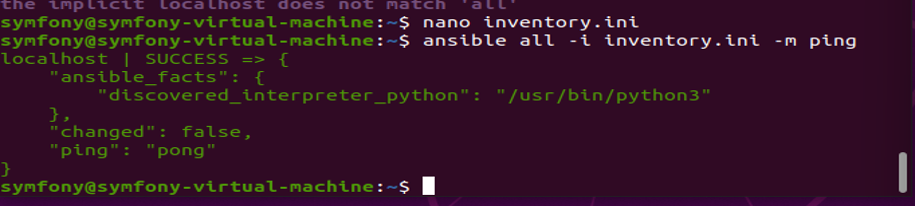
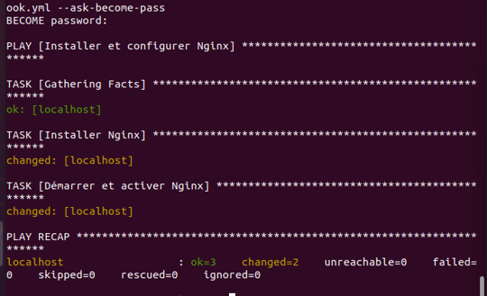
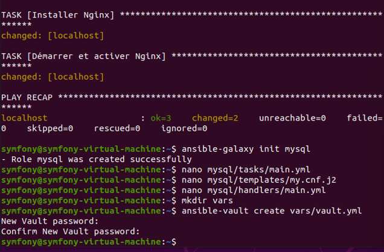
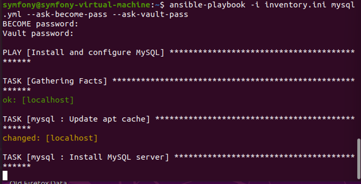

# ⚙️ Ansible Configuration — TP Administration Système


## 📋 Objectif

Mise en place d'une **infrastructure automatisée avec Ansible** sur une machine Linux Ubuntu, incluant l'installation de services, la gestion de rôles, de templates et la sécurisation des variables sensibles avec Ansible Vault.

---

## 🏗️ Architecture du projet

```
ansible-configuration/
│
├── ansible.cfg              # Configuration Ansible (SSH, host checking)
├── inventory.ini            # Inventaire des machines (localhost)
├── playbook.yml             # Playbook Nginx
├── mysql.yml                # Playbook MySQL avec rôle
│
├── mysql/                   # Rôle Ansible MySQL
│   ├── tasks/main.yml       # Tâches d'installation
│   ├── handlers/main.yml    # Handler restart MySQL
│   ├── templates/my.cnf.j2  # Template configuration MySQL
│   ├── defaults/main.yml    # Variables par défaut
│   └── meta/main.yml        # Métadonnées du rôle
│
├── vars/
│   └── vault.yml            # Variables chiffrées (Ansible Vault AES-256)
│
└── screenshots/             # Captures d'écran du TP
```

---

## 🛠️ Stack technique

| Outil | Version | Rôle |
|---|---|---|
| **Ansible** | 2.9.6 | Outil d'automatisation principal |
| **Nginx** | 1.24.0 | Serveur web installé via playbook |
| **MySQL** | 8.0 | Base de données installée via rôle |
| **Ansible Vault** | AES-256 | Chiffrement des variables sensibles |
| **Ubuntu** | 20.04 LTS | Système d'exploitation |
| **OpenSSH** | 8.2p1 | Communication sécurisée SSH |

---

## 🚀 Installation & Utilisation

### Prérequis

```bash
sudo apt update
sudo apt install -y ansible
ansible --version
```

### Configuration SSH

```bash
ssh-keygen -t rsa -b 2048
cat ~/.ssh/id_rsa.pub >> ~/.ssh/authorized_keys
chmod 600 ~/.ssh/authorized_keys
ssh localhost
```

### Tester la connectivité

```bash
ansible all -i inventory.ini -m ping
```

### Déployer Nginx

```bash
ansible-playbook -i inventory.ini playbook.yml --ask-become-pass
```

### Déployer MySQL (avec Vault)

```bash
ansible-playbook -i inventory.ini mysql.yml --ask-become-pass --ask-vault-pass
```

### Gérer le fichier Vault

```bash
# Créer
ansible-vault create vars/vault.yml

# Modifier
ansible-vault edit vars/vault.yml

# Voir le contenu
ansible-vault view vars/vault.yml
```

---

## 📸 Captures d'écran

### ✅ Étape 1 — Installation Ansible (`ansible --version`)



---

### ✅ Étape 2 — Vérification SSH (`ssh -V`)



---

### ✅ Étape 3 — Connexion SSH localhost



---

### ✅ Étape 4 — Test ping Ansible → pong



---

### ✅ Étape 5 — Exécution Playbook Nginx



---

### ✅ Étape 6 — Création rôle MySQL + Ansible Vault



---

### ✅ Étape 7 — Exécution Playbook MySQL avec Vault



---

## ✅ Résultats

| Étape | Commande | Résultat |
|---|---|---|
| Installation Ansible | `ansible --version` | ✅ v2.9.6 |
| Configuration SSH | `ssh localhost` | ✅ Connexion OK |
| Test connectivité | `ansible all -m ping` | ✅ pong |
| Playbook Nginx | `ansible-playbook playbook.yml` | ✅ ok=3 changed=2 failed=0 |
| Rôle MySQL | `ansible-galaxy init mysql` | ✅ Créé avec succès |
| Ansible Vault | `ansible-vault create vault.yml` | ✅ Chiffré AES-256 |
| Playbook MySQL | `ansible-playbook mysql.yml` | ✅ En cours d'exécution |

---

## 👤 Auteur

**fatimazahrasidhoum23-spec**  
TP Administration Système — Ansible Automation
